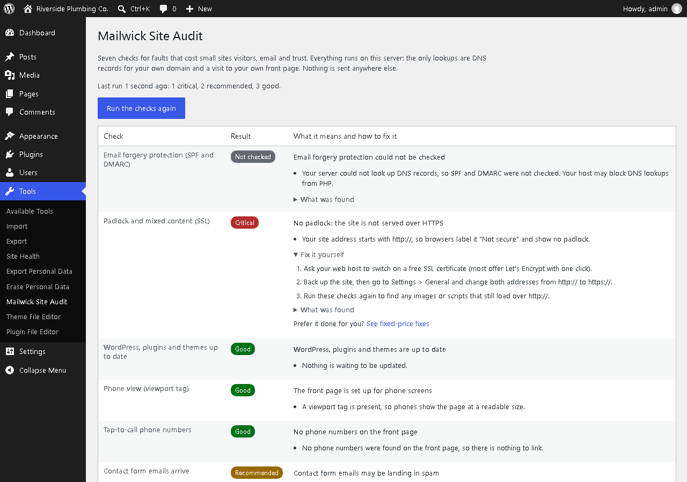

# Mailwick Site Audit

A WordPress plugin that checks the faults that quietly cost a small business
website visitors, email and trust, and explains each one in plain English with
short steps to fix it yourself.

It adds **Tools > Mailwick Site Audit** and puts its checks into
**Tools > Site Health**.

## The seven checks

1. **Email forgery (SPF and DMARC)** - is DMARC missing or `p=none`, so anyone
   can send mail that looks like it came from your domain?
2. **Padlock and mixed content** - https, a certificate that verifies, http
   redirecting to https, no insecure scripts or images on the front page.
3. **Out-of-date WordPress, plugins and themes** - from the update data
   WordPress already stores (no extra update calls).
4. **Phone view** - a viewport tag, so phones do not show a shrunken desktop page.
5. **Tap-to-call** - phone numbers written as plain text instead of `tel:` links.
6. **Contact form deliverability** - is a mail-sending plugin (WP Mail SMTP,
   FluentSMTP, Post SMTP...) active, or does form mail leave from the web server?
7. **Search snippet** - a meta description on the front page.

Each result is **Critical**, **Recommended** or **Good**, with the evidence found
and numbered fix steps.

## Private by design

No account, no API key, no tracking. The plugin makes DNS lookups for your own
domain and loads your own front page - nothing else leaves your site. No
dashboard notices or ads; one "Prefer it done for you?" link appears on the
plugin's own page, under a failing check only.

## Install

In WordPress: **Plugins > Add New**, search **Mailwick Site Audit**, Install, Activate -
or see the listing at [wordpress.org/plugins/mailwick-site-audit](https://wordpress.org/plugins/mailwick-site-audit/).

Or download `mailwick-site-audit.zip` from the
[latest release](https://github.com/Stephen-Psaradellis/mailwick-site-audit/releases/latest),
then **Plugins > Add New > Upload Plugin**. Requires WordPress 5.8+ and PHP 7.4+;
tested up to 7.1.

## Related

- No WordPress? The same SPF/DKIM/DMARC check runs in a browser:
  [email-forgery-check](https://stephen-psaradellis.github.io/demos/email-forgery-check.html)
  ([source](https://github.com/Stephen-Psaradellis/email-forgery-check)).
- Worked examples of each fix, broken then fixed:
  [stephen-psaradellis.github.io/demos](https://stephen-psaradellis.github.io/demos/).

Written with an AI system (Claude) under my direction; I review and maintain it.
Issues and pull requests welcome.

## License

GPLv2 or later, like WordPress itself. See `LICENSE`.
